<div align="center">

<picture>
  <source media="(prefers-color-scheme: dark)" srcset="docs/media/banner-dark.svg">
  
</picture>

Build a team of agents from skills, launch it into your project, and see who is thinking, typing and talking, live.

[](https://github.com/niklan1110/agentic-office/actions)
[](LICENSE)


[Quick start](#quick-start) · [Features](#features) · [Layouts](#six-layouts) · [Troubleshooting](#troubleshooting) · [Share your office](#share-your-office)

</div>

<p align="center">
  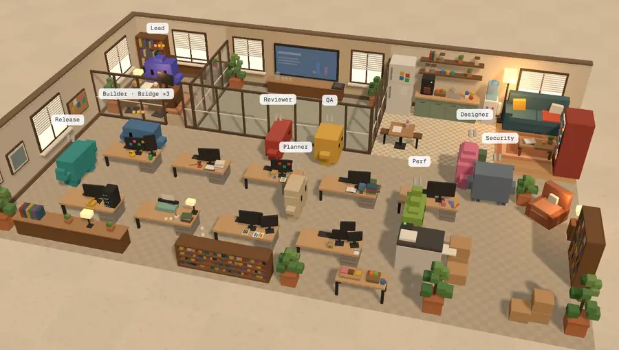
</p>

> [!NOTE]
> Agent Office runs only on your computer. There is no account, no cloud and no build step. It needs Node 22+ and [Claude Code](https://claude.com/claude-code) in VS Code, the terminal or the desktop app. Claude Code on the web is not supported.

## Quick start

Choose one of two ways:

**A. One command**, run in your project folder:

```bash
npx github:niklan1110/agentic-office
```

It finds your Claude Code (including the one inside VS Code), offers to add the plugin, starts the office and opens it in your browser.

**B. One prompt.** Paste this into Claude Code in your project:

```text
Set up Agent Office for this project: run `npx github:niklan1110/agentic-office plugin install`,
then start the office in the background with `npx github:niklan1110/agentic-office --no-open`
from this folder, and give me the link it prints.
```

Then, in the browser:

1. **Build your team.** Start each agent from a role (developer, reviewer, QA, designer and more) or from blank. Name it and give it skills.
2. **Launch.** Each agent becomes a Claude Code subagent in `.claude/agents/`, with its skills preloaded.
3. **Watch.** Give the team work in the office or in any Claude Code session ("Have ada build the sign-up form, then qa test it"), and the office comes alive.

## Features

### A team in two minutes

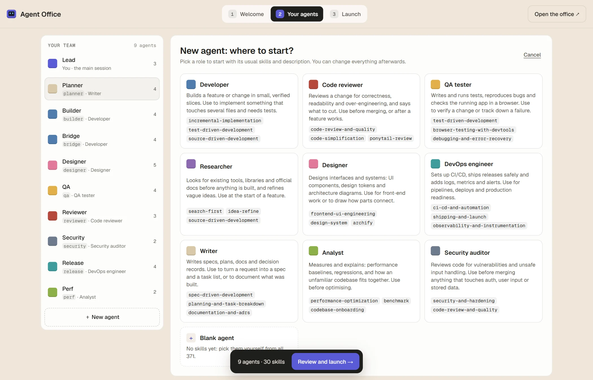

- **Roles with sensible skills.** Every new agent starts from a role and its usual skills, or from blank.
- **Skills grouped by area.** Planning, web, design, backend, testing, security, DevOps, AI agents and more. Each skill comes with a one-line description, and a Suggested tab shows what fits the role.
- **What Claude sees.** A preview shows exactly how Claude will read each agent when deciding who gets a task.

### Skills from anywhere

Found a skill on GitHub? Click **Add skills**, then paste a link to a repository, a folder or a `SKILL.md`, or drop a `.zip`. Pick the skills you want. They go into your personal library (`~/.agent-office/skills`) and show up in every project.

### Six layouts

<table>
  <tr>
    <td width="33%">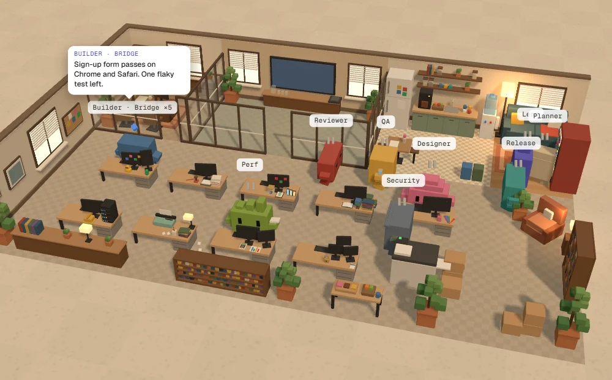<br><sub><b>Open plan</b></sub></td>
    <td width="33%">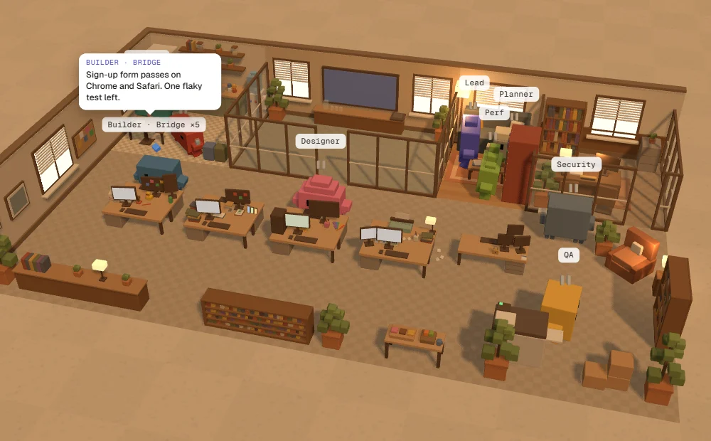<br><sub><b>Pairs</b></sub></td>
    <td width="33%">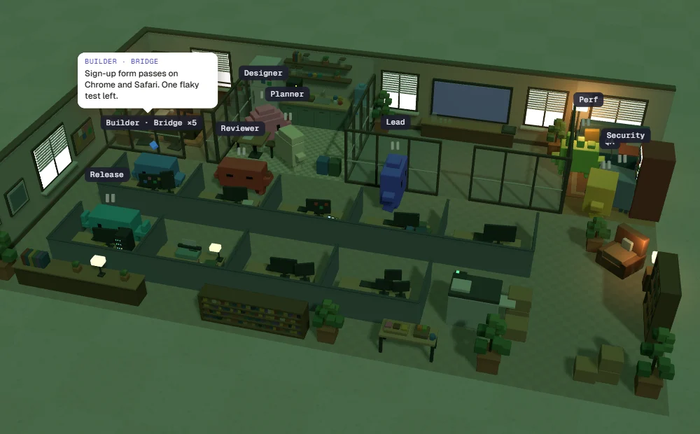<br><sub><b>Cubicle farm</b></sub></td>
  </tr>
  <tr>
    <td width="33%">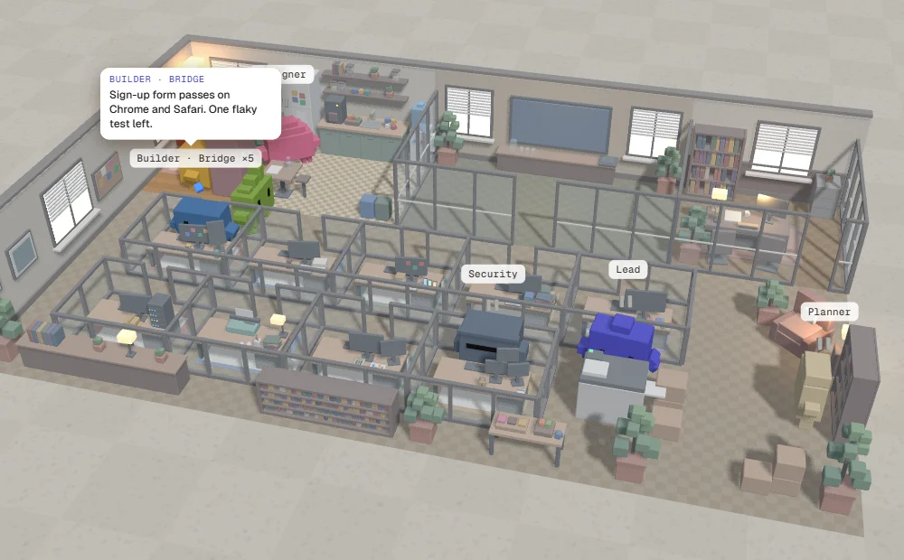<br><sub><b>Private offices</b></sub></td>
    <td width="33%">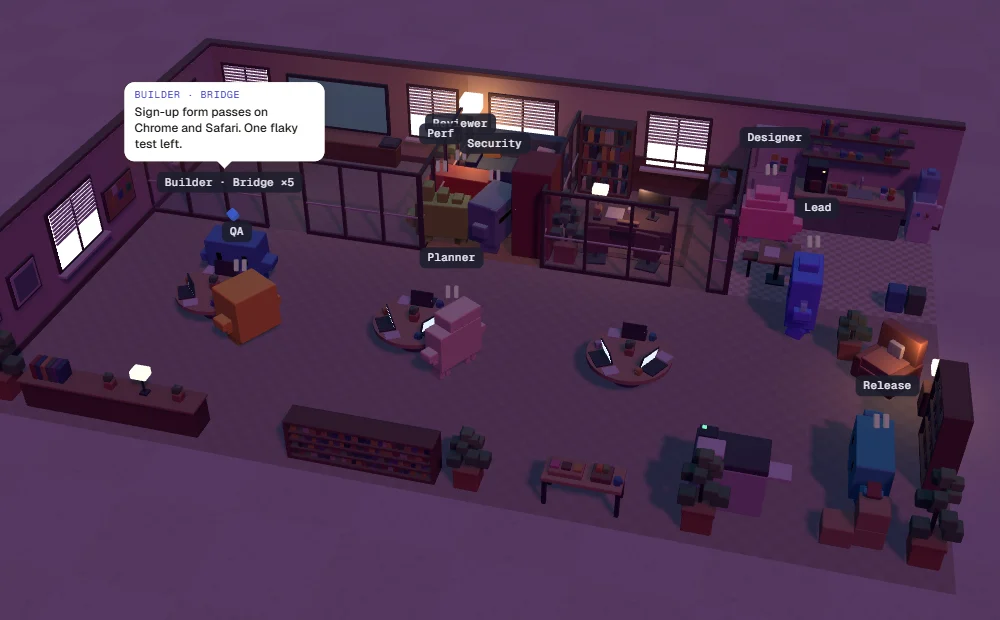<br><sub><b>Round tables</b></sub></td>
    <td width="33%">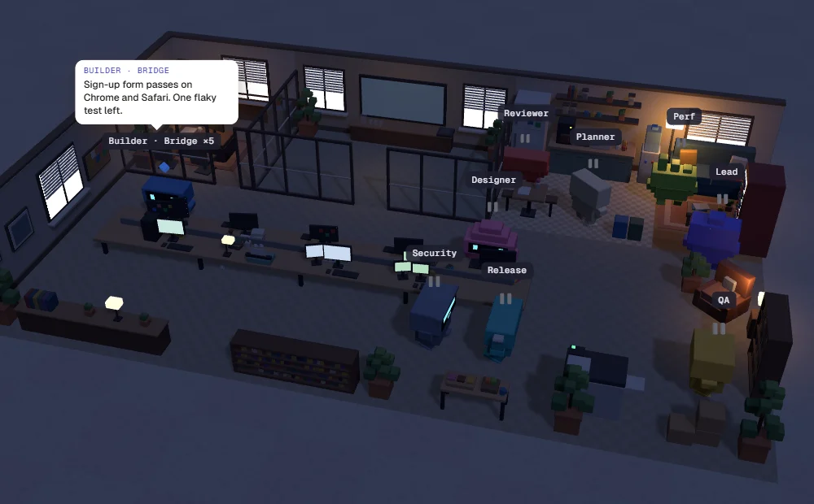<br><sub><b>Long table</b></sub></td>
  </tr>
</table>

Pick the floor plan for your team: an open plan, desks in pairs, a Matrix-style cubicle farm, glass-walled private offices, round tables or one long bench. Each layout also rearranges the manager's office, the conference room, the kitchen and the lounge, and agents find their way to their own seats in every one.

### Six colour themes, or your own

<table>
  <tr>
    <td width="33%">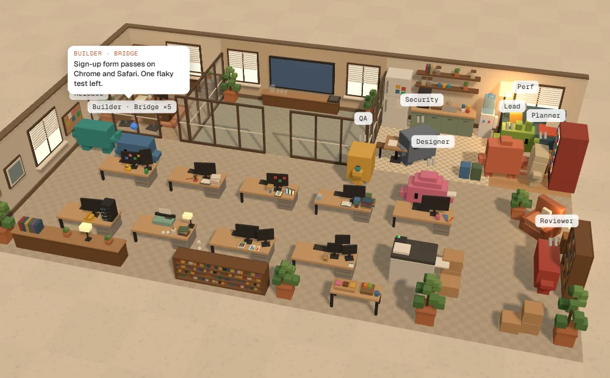<br><sub><b>Warm studio</b></sub></td>
    <td width="33%">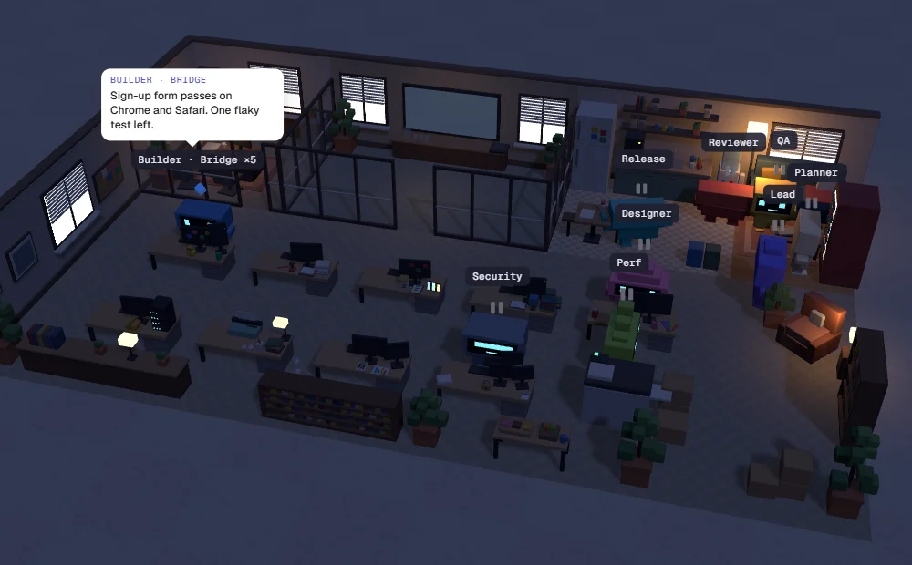<br><sub><b>Late night</b></sub></td>
    <td width="33%">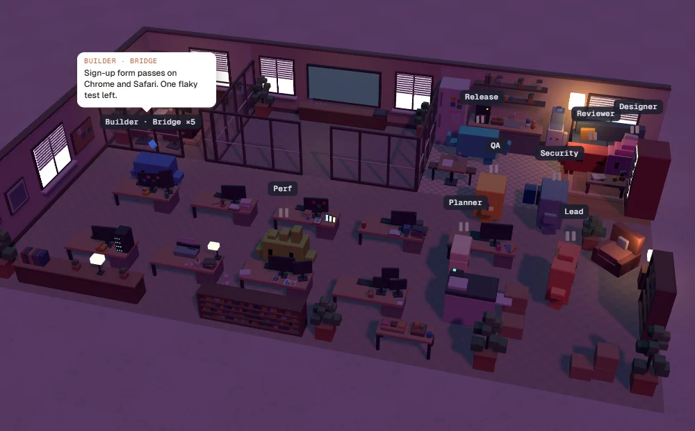<br><sub><b>Neon arcade</b></sub></td>
  </tr>
  <tr>
    <td width="33%">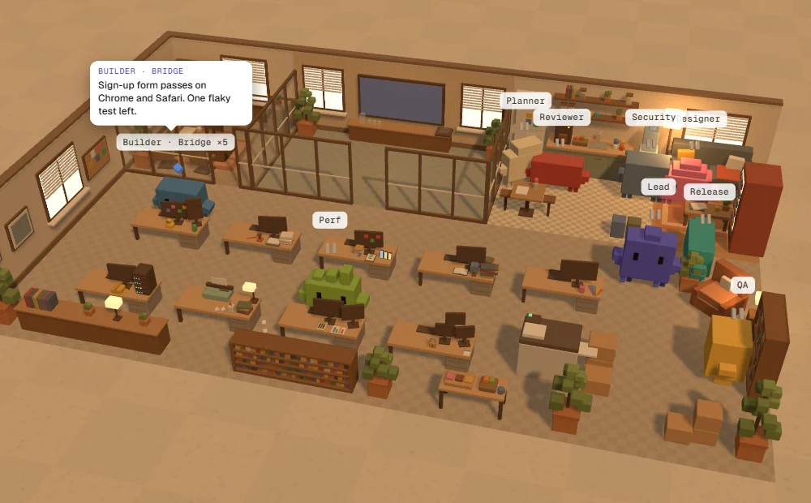<br><sub><b>Cozy cabin</b></sub></td>
    <td width="33%">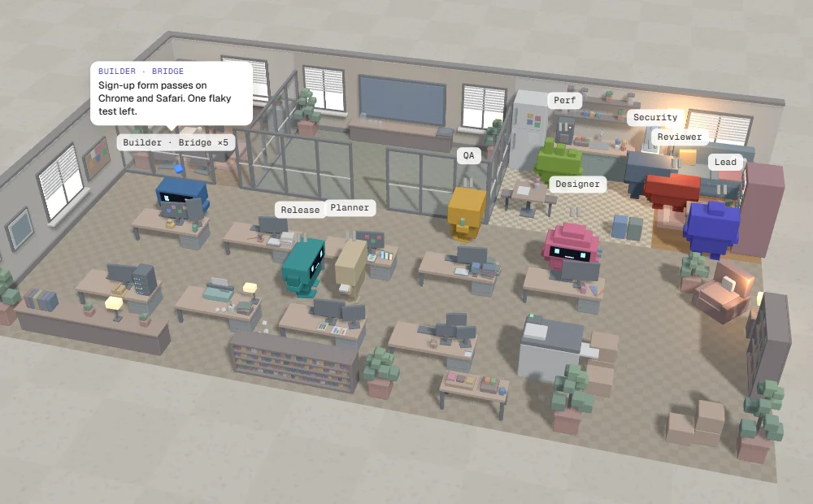<br><sub><b>Glass HQ</b></sub></td>
    <td width="33%">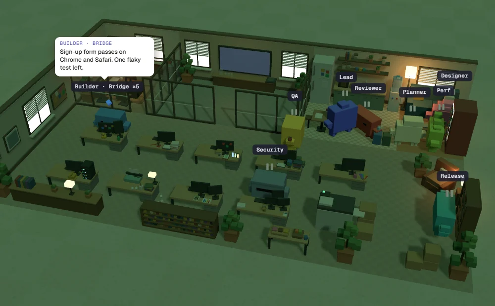<br><sub><b>Matrix</b></sub></td>
  </tr>
</table>

Any layout works with any colours, and you can pick your own colours for the walls, floor and partitions on top of a theme. **Look** in the office also switches the characters between Classic (blocky, flat black eyes) and Bots (screen faces with glowing eyes). Change it all when you launch, or any time from **Look**. Press <kbd>H</kbd> to hide the controls for a clean screenshot like these.

### Every office, and your phone

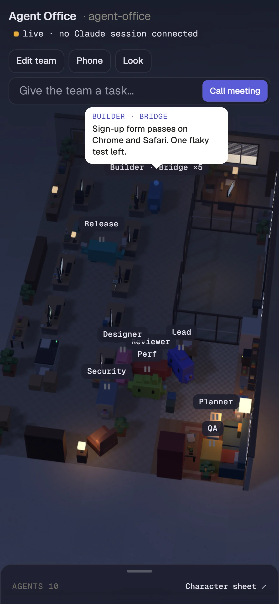

- **Offices** lists every office running on your computer, one per project. Each card shows its theme, how many agents are busy, and whether a session is connected.
- **Phone** shows a QR code. Scan it on the same Wi-Fi to watch the office from the couch. The phone link is watch-only: it can't change your team or reach Claude Code, and it stops working when you turn it off.
- **The office in the browser** works with touch and on small screens. It draws lighter on phones and pauses in hidden tabs.

<br clear="right">

## Controls

| | |
|---|---|
| Drag / scroll | Orbit / zoom the office |
| Click a character | Its details, tool calls and tokens |
| <kbd>H</kbd> | Hide the controls (clean screenshot) |
| **Call meeting** | Brief the team and send the task to Claude Code |
| **Look** · **Phone** · **Offices** | Layout and colours, watch from your phone, all your offices |
| `/office` in Claude Code | What this session sees, and what to fix |

## Troubleshooting

<details>
<summary><b>The office says "no Claude session connected"</b></summary>

Run `npx github:niklan1110/agentic-office doctor`. It checks Node, Claude Code, the plugin and its version, old plugins that compete with it, the server and your skills, and gives the fix for each problem.

Inside Claude Code, run `/office` to see what the session sees. In the office, click the connection chip under the title for the list of sessions that have checked in.
</details>

<details>
<summary><b>"/plugin isn't available in this environment" (VS Code)</b></summary>

Install the plugin from a terminal instead: `npx github:niklan1110/agentic-office plugin install`. It uses the newest Claude Code it can find, including the one inside VS Code.
</details>

<details>
<summary><b>New agents don't show up in a session that was already open</b></summary>

Claude Code reads `.claude/agents/` when a session starts. With the plugin, an open session gets a newly launched team straight away. Without it, start a new session. Skills are picked up mid-session; if the project had no `.claude/skills/` folder when the session started, run `/reload-skills`.
</details>

<details>
<summary><b>The phone can't open the link</b></summary>

The phone and the computer must be on the same Wi-Fi. The first time, Windows asks whether to let Node accept connections on private networks: allow it. If the link has stopped working, turn phone viewing off and on again for a fresh QR code.
</details>

<details>
<summary><b>Options</b></summary>

```text
agentic-office [start] [--project <dir>] [--skills <dir>]... [--port <n>] [--strict-port] [--no-open] [-y] [--no-plugin]
agentic-office plugin install [--local]
agentic-office doctor [--project <dir>]
```

| Option | Default | |
|---|---|---|
| `--project` | current folder | The project the team is launched into. |
| `--skills` | none | A folder of skills to pick from (one folder per skill, with a `SKILL.md`). Repeat for more, or set `AGENT_OFFICE_SKILLS`. |
| `--port` | 7777 | The first port to try; the next free one is used if it is taken. |
| `-y`, `--no-plugin` | ask | Install the plugin without asking, or never offer it. |

The plugin's options are under `/plugin` → agent-office → configure. Leave **Office URL** empty: the plugin finds the office by itself.

**What launching writes**, all under the project's `.claude/`:

- `agents/<name>.md`, one per agent. A file the office did not write is never touched.
- `skills/<skill>/`, a copy of each assigned skill.
- `office-team.json`, the team.
- `agent-office/`, the theme and the running server's address.

</details>

## Share your office

Took a screenshot you like? Post it with **#AgentOffice**, or share it in [Discussions → Show and tell](https://github.com/niklan1110/agentic-office/discussions). Press <kbd>H</kbd> first to hide the controls.

## Contributors

<a href="https://github.com/niklan1110/agentic-office/graphs/contributors"></a>

## Star history

<a href="https://star-history.com/#niklan1110/agentic-office&Date">
  <picture>
    <source media="(prefers-color-scheme: dark)" srcset="https://api.star-history.com/svg?repos=niklan1110/agentic-office&type=Date&theme=dark">
    
  </picture>
</a>

## Contributing

Issues and pull requests are welcome. [CONTRIBUTING.md](CONTRIBUTING.md) has the setup (no build step: `npm test`, then `npm start`), and [docs/spec.md](docs/spec.md) explains the design. To report a security problem, see [SECURITY.md](SECURITY.md).

## License

Agent Office is an independent project. It is not made by, affiliated with or endorsed by Anthropic. Claude and Claude Code are trademarks of Anthropic.

[MIT](LICENSE). Agent Office includes three.js (MIT), qrcode-generator (MIT) and the Geist fonts (OFL); see [THIRD_PARTY_NOTICES.md](THIRD_PARTY_NOTICES.md). Skills you add keep their own licenses. The 3D office follows the design handoff in [docs/design/](docs/design/).
